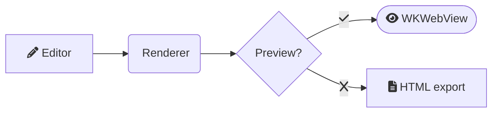
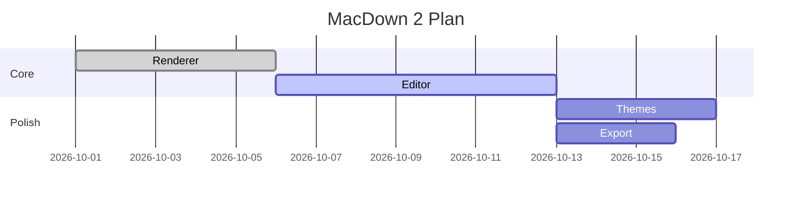
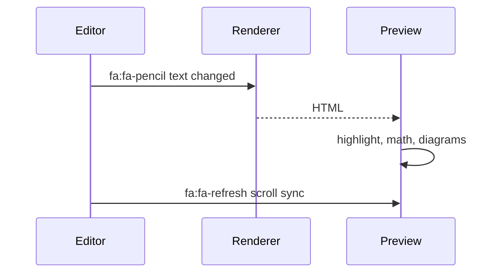
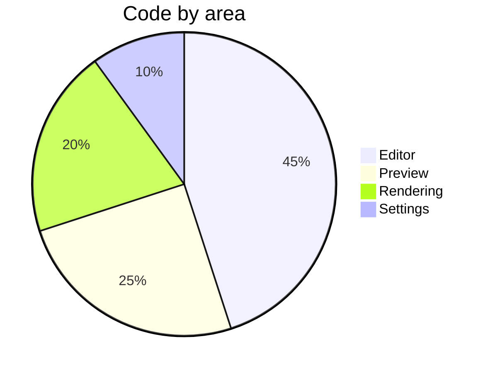

# MacDown 2 showcase

> Turn on **Settings → Rendering → TeX math** for the formulas. Diagrams render with Pele (look: *White*) by default.

A **modern** rewrite with *SwiftUI* and `WKWebView`. ~~Old WebView~~ is gone.

## Lists

- [x] Swift 6
- [ ] Tasks
  - nested item
1. First
2. Second

> Blockquote with a [link](https://example.com) and an autolink https://apple.com.

| Feature | Status | Notes |
|---------|:------:|-------|
| :table: Tables | :circle-check: | GFM pipes |
| :file-text: Footnotes[^1] | :circle-check: | cmark-gfm |
| :zap: Pele diagrams | :circle-check: | looks + motion |
| :globe: Old WebView | :circle-x: | gone |

Icons are [Lucide](https://lucide.dev) shortcodes: `:rocket:` :rocket: `:database:` :database: `:shield:` :shield: `:lightbulb:` :lightbulb:

```swift
struct Hello: View {
    var body: some View { Text("Hello, world") }
}
```

Math: $e^{i\pi} + 1 = 0$ and

$$\int_0^\infty e^{-x^2}\,dx = \frac{\sqrt{\pi}}{2}$$










---

[^1]: A footnote.
