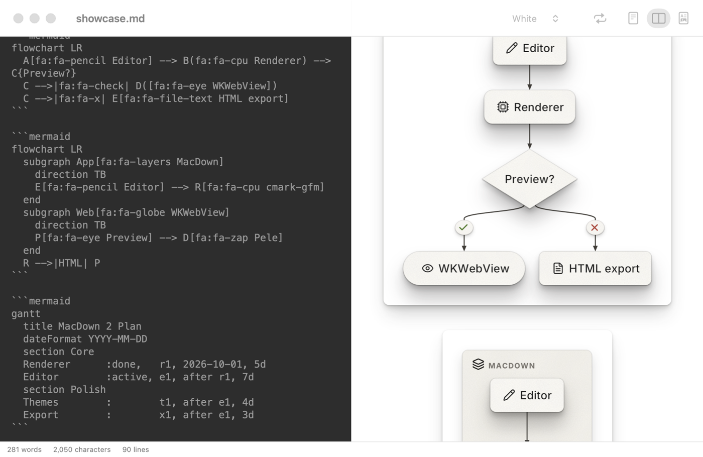
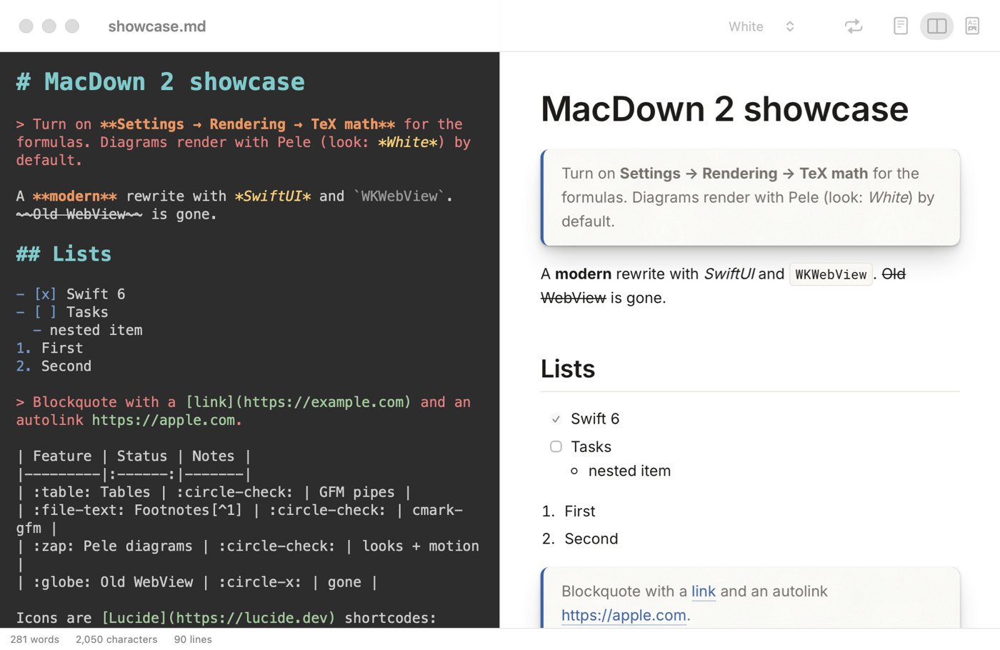
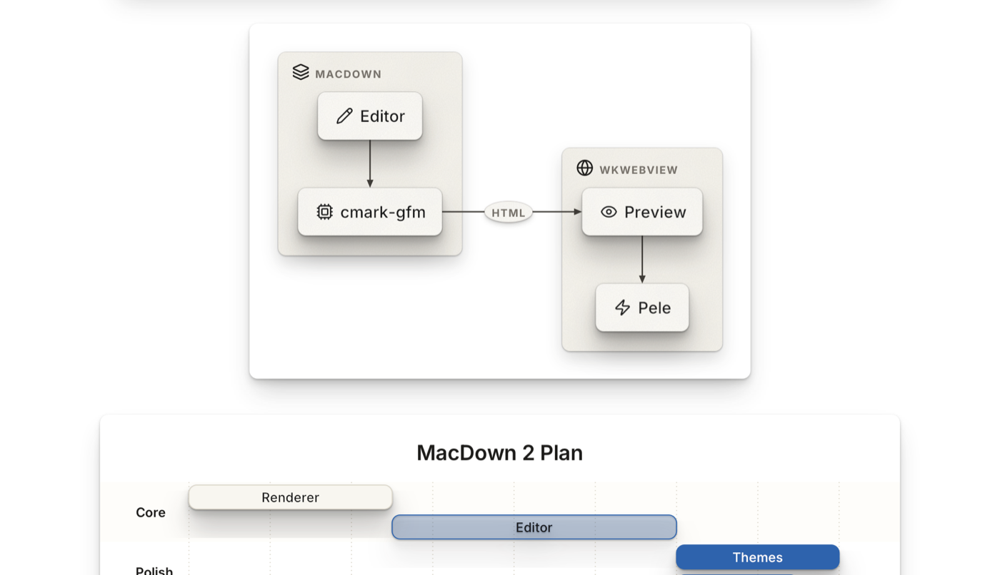
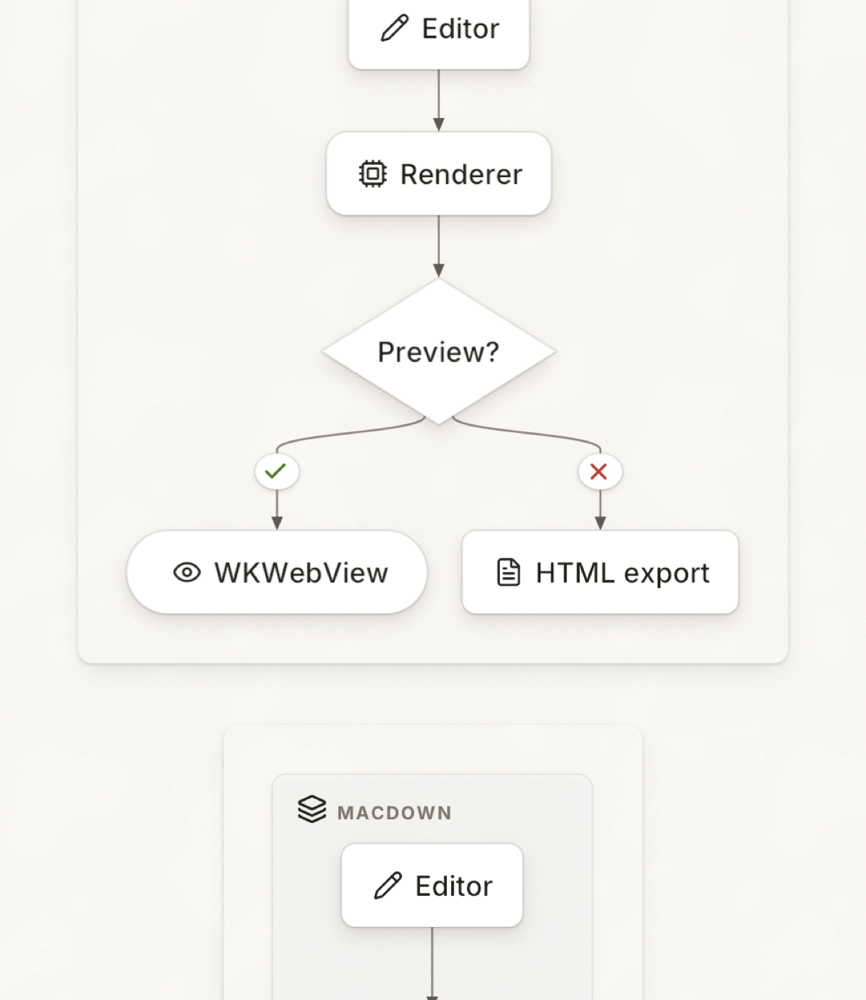
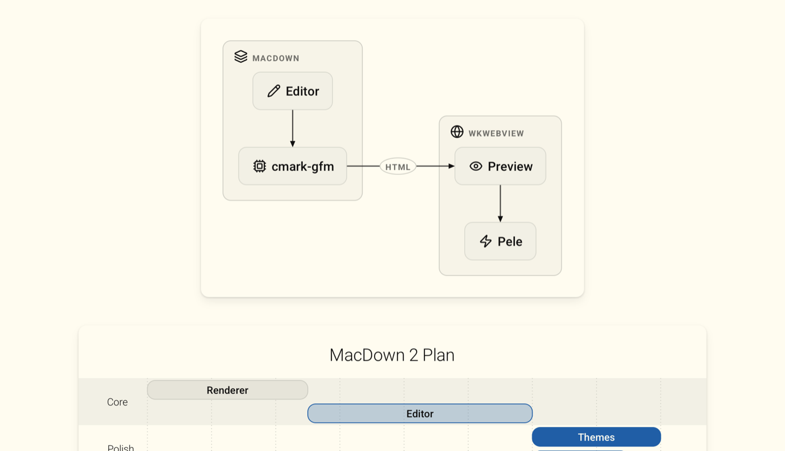
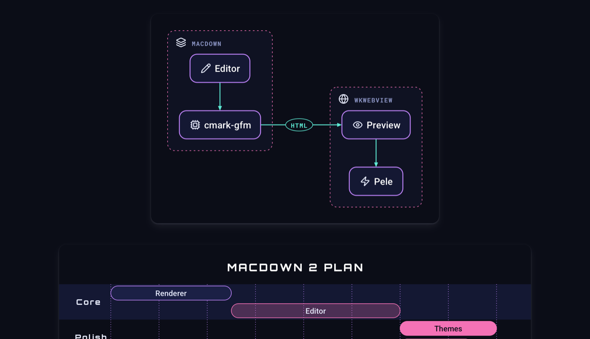
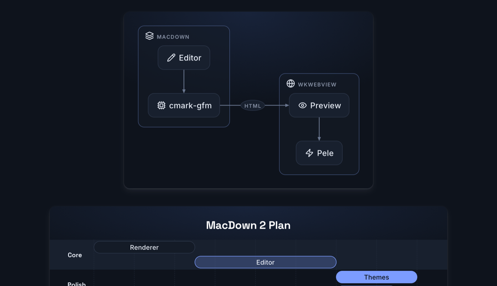
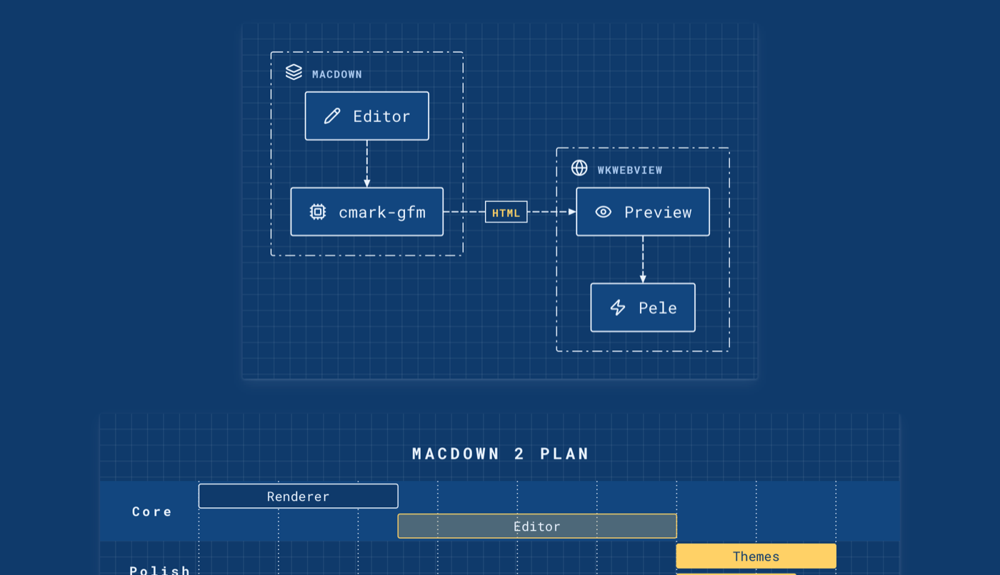
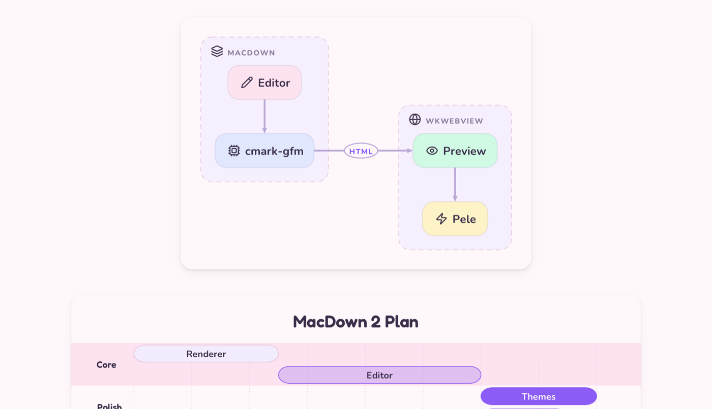

# MacDown 2 — SwiftUI + WKWebView

A ground-up rewrite of [MacDown](https://github.com/MacDownApp/macdown) for current macOS: a SwiftUI app
shell, a native Markdown editor, a `WKWebView` live preview, and diagrams drawn by
[Pele](https://pele.run) in themeable *looks* with drop shadows and motion.





## Features

- **Editor** — `NSTextView` (TextKit 1) with Markdown syntax highlighting driven by MacDown's original
  `.style` themes; list / blockquote continuation, auto-pairing, smart Tab / Shift-Tab, and a **Format**
  menu (bold, italic, code, links, headings ⌘1–6, lists, quotes).
- **Preview** — `WKWebView` with incremental DOM patching (unchanged blocks keep their nodes, so code
  highlighting, math and diagram animations aren't redone on every keystroke) and line-accurate scroll sync
  via cmark's `data-sourcepos`.
- **Markdown** — [swift-cmark](https://github.com/swiftlang/swift-cmark) (cmark-gfm): tables, strikethrough,
  autolinks, task lists, footnotes, smart punctuation.
- **Diagrams** — ```` ```mermaid ```` blocks drawn by Pele (fast, synchronous, every Mermaid 12 diagram
  type; no Mermaid runtime is shipped). Pick a **look** (default: *White*) and **motion** from the toolbar;
  **Replay** (⌥⌘R) plays the intro and then loops.
- **Page looks** — the *Pele* preview stylesheet makes the whole page wear the diagram look: fonts,
  palette, textured surfaces and lifted cards.
- **Icons** — `:circle-check:`, `:database:`, `:rocket:` … become inline [Lucide](https://lucide.dev) SVGs;
  `fa:fa-check` works inside diagrams.
- **Code & math** — Prism 1.29 (bundled, autoloaded languages), MathJax 3 (SVG, offline).
- **Export** — HTML (styles inlined, diagrams/math/highlighting baked in), PDF, Print, Copy HTML.

## Looks

| White (default) | Paper |
|---|---|
|  |  |
| **Elevated** | **Neon** |
|  |  |
| **Midnight** | **Blueprint** |
|  |  |
| **Pastel** | |
|  | |

*Paper* (fine grain, layered sheets) and *White* (white page, textured paper cards, strong stacked shadows)
are new in this fork of Pele. Shadows inside diagrams are SVG filters carried by each drawing — WebKit
doesn't paint CSS `drop-shadow()` on SVG shapes — and are switched off while a piece animates in, so the
intro stays at 60 fps.

## Build

```sh
cd MacDownSwift
xcodegen generate            # brew install xcodegen
xcodebuild -project MacDown.xcodeproj -scheme MacDown -configuration Debug -derivedDataPath build build
open build/Build/Products/Debug/MacDown.app Examples/showcase.md
```

Requires Xcode 16+ and macOS 14+. User themes (`.style`) and preview CSS go in
`~/Library/Application Support/MacDown/{Themes,Styles}`.

## Layout

```
Sources/
  App/        MacDownApp (DocumentGroup, Settings), menu commands
  Document/   FileDocument, window view + toolbar, export/print bridge
  Editor/     NSTextView subclass, highlighter, .style theme parser
  Preview/    WKWebView representable
  Rendering/  cmark-gfm renderer (+ math protection), HTML page builder
  Settings/   preferences + Settings window
  Debug/      DEBUG-only snapshot hook used for testing and these screenshots
Resources/
  Web/        macdown.js runtime, Pele (pele/pele.global.js), Prism (code), MathJax (TeX math)
  Styles/     preview CSS (Pele.css + MacDown's originals)
  Themes/     editor themes
```

`Resources/Web/pele/pele.global.js` is built from Pele's `looks` branch with the *paper* and *white*
looks added (`npm run build` in the Pele repo, then copy `dist/pele.global.js`).

## Credits & licenses

MacDown (MIT) · Pele by kepano (MIT) · Lucide icons (ISC) · Prism (MIT) · MathJax (Apache-2.0) ·
cmark-gfm (BSD-2). License files are bundled next to each library.
