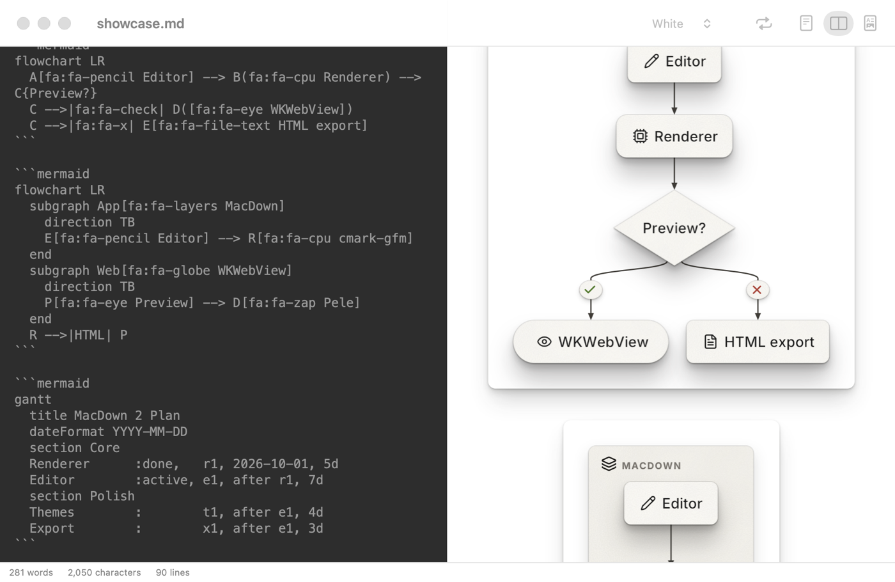
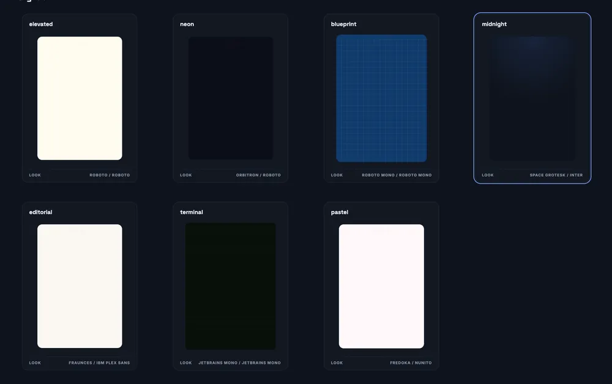

> **MacDown 2 (SwiftUI + WKWebView rewrite)** lives in [`MacDownSwift/`](MacDownSwift/) — see its
> [README](MacDownSwift/README.md) for features, screenshots and build steps. The original Objective-C app
> below is kept for reference.
>
> 

https://github.com/user-attachments/assets/0de5866b-59e5-45c8-b087-5da4da902636

# MacDown

See the original MacDown repo here: https://github.com/MacDownApp/macdown
